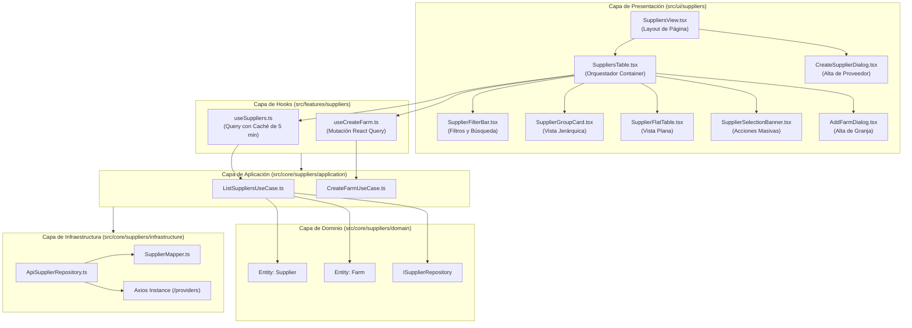

# Análisis Arquitectónico y Funcional: Tabla de Proveedores

Este documento detalla la estructura, arquitectura, componentes y flujo de datos del módulo y tabla de **Proveedores** (`Suppliers`) dentro de la plataforma Ganadera.

---

## 1. Arquitectura General y Capas (Clean Architecture / DDD-Lite)

El módulo sigue estrictamente la arquitectura desacoplada del sistema:



---

## 2. Entidades de Dominio y Modelo de Datos

### 2.1. Entidad Proveedor (`Supplier`)
Definida en [`src/core/suppliers/domain/entities/Supplier.ts`](file:///Users/anthonylaverde/Desktop/proyecto_jhoangel/Fuse-React-v16.0.0-vitejs-skeleton/src/core/suppliers/domain/entities/Supplier.ts).

| Propiedad | Tipo | Requerido | Descripción | Reglas de Dominio |
| :--- | :--- | :---: | :--- | :--- |
| `id` | `number` | Sí | Identificador primario en backend. | Inmutable tras creación. |
| `name` | `string` | Sí | Razón Social / Nombre del proveedor. | Obligatorio, no vacío (`trim`). |
| `commercial_name`| `string \| null` | No | Nombre de fantasía o comercial. | Opcional. |
| `cuit` | `string` | Sí | Identificación fiscal argentina (CUIT). | Obligatorio, formato fiscal. |
| `location` | `string \| null` | No | Domicilio, provincia o localidad. | Opcional. |
| `email` | `string \| null` | No | Correo electrónico de contacto. | Formato email válido. |
| `phone` | `string \| null` | No | Teléfono de contacto. | Opcional. |
| `is_active` | `boolean` | Sí | Estado operativo. | Por defecto `true`. |
| `farms` | `Farm[]` | No | Colección de granjas/establecimientos. | Array de instancias `Farm`. |
| `created_at` | `string` | No | Timestamp de auditoría de creación. | ISO 8601. |

### 2.2. Entidad Establecimiento / Granja (`Farm`)
Definida en [`src/core/suppliers/domain/entities/Farm.ts`](file:///Users/anthonylaverde/Desktop/proyecto_jhoangel/Fuse-React-v16.0.0-vitejs-skeleton/src/core/suppliers/domain/entities/Farm.ts).

| Propiedad | Tipo | Requerido | Descripción |
| :--- | :--- | :---: | :--- |
| `id` | `number` | Sí | Identificador único del establecimiento. |
| `name` | `string` | Sí | Nombre del establecimiento / campo. |
| `renspa` | `string` | Sí | Código sanitario ganadero nacional. |
| `provider_id` | `number` | Sí | Clave foránea al proveedor padre (`provider_id > 0`). |
| `location` | `string \| null` | No | Ubicación geográfica. |
| `is_active` | `boolean` | Sí | Estado operativo del campo. |
| `batches` | `Batch[]` | No | Lotes asignados o vinculados. |

---

## 3. Desglose de Componentes de Presentación

### 3.1. Vista y Enrutamiento
- **Ruta:** `/providers` en [`src/app/(control-panel)/providers/route.tsx`](file:///Users/anthonylaverde/Desktop/proyecto_jhoangel/Fuse-React-v16.0.0-vitejs-skeleton/src/app/(control-panel)/providers/route.tsx).
- **Vista Principal ([`SuppliersView.tsx`](file:///Users/anthonylaverde/Desktop/proyecto_jhoangel/Fuse-React-v16.0.0-vitejs-skeleton/src/ui/suppliers/views/SuppliersView.tsx)):**
  - Contenedor estandarizado con `ViewLayout`.
  - Escucha parámetros de URL (`?action=create` o `?new=true`) para desplegar automáticamente el diálogo de creación.
  - Botones de acción superior: `Exportar` y `Nuevo Proveedor` (abre [`CreateSupplierDialog`](file:///Users/anthonylaverde/Desktop/proyecto_jhoangel/Fuse-React-v16.0.0-vitejs-skeleton/src/ui/suppliers/components/CreateSupplierDialog.tsx)).

### 3.2. Orquestador ([`SuppliersTable.tsx`](file:///Users/anthonylaverde/Desktop/proyecto_jhoangel/Fuse-React-v16.0.0-vitejs-skeleton/src/ui/suppliers/components/SuppliersTable.tsx))
- **Responsabilidad Única (SRP):** Menos de 240 líneas. Controla los estados compartidos:
  - `viewMode`: Conmutador entre `'hierarchy'` y `'flat'`.
  - `searchTerm`: Filtro predictivo de texto.
  - `selectedStatus`: Filtro por estado (`'ALL'`, `'ACTIVE'`, `'INACTIVE'`).
  - `selectedSupplierIds`: Conjunto de IDs seleccionados para acciones masivas.
  - `page` y `rowsPerPage`: Paginación del modo plano.
  - Exportación nativa a archivo `.csv`.

### 3.3. Barra de Herramientas y Filtros ([`SupplierFilterBar.tsx`](file:///Users/anthonylaverde/Desktop/proyecto_jhoangel/Fuse-React-v16.0.0-vitejs-skeleton/src/ui/suppliers/components/SupplierFilterBar.tsx))
- **Buscador Omnibox:** Búsqueda en vivo sensible a Razón Social, Nombre Comercial, CUIT, nombre de granja o RENSPA.
- **Filtro de Estado:** Selector de menú con `Todos los Estados`, `Solo Activos` y `Solo Inactivos`.
- **Badge Resumen:** Chip visual con conteo dinámico (`X proveedores • Y granjas`).
- **Botón Conmutador:** Alterna el modo de visualización entre Jerárquico y Tabla Plana.
- **Botón Seleccionar Todo:** Permite selección masiva con un solo clic.

### 3.4. Modo Jerárquico ([`SupplierGroupCard.tsx`](file:///Users/anthonylaverde/Desktop/proyecto_jhoangel/Fuse-React-v16.0.0-vitejs-skeleton/src/ui/suppliers/components/SupplierGroupCard.tsx))
- Presenta cada proveedor como una tarjeta seccional con borde temático.
- Cabecera con icono, CUIT resaltado en monospace, datos de contacto (email, teléfono), chip de granjas totales y chip de estado.
- **Sub-tabla de Establecimientos Embebida:**
  - Columnas: `#`, `Establecimiento / Granja`, `Ubicación`, `RENSPA`, `Estado`.
  - Si no tiene establecimientos, muestra un estado vacío con botón directo para "Registrar primer establecimiento".
  - Botón de acción rápida: `Añadir Granja` (`+`) y `Ver Detalles` (ojo) que navega hacia `/batches/external-assignment?supplierId={id}`.

### 3.5. Modo Tabla Plana ([`SupplierFlatTable.tsx`](file:///Users/anthonylaverde/Desktop/proyecto_jhoangel/Fuse-React-v16.0.0-vitejs-skeleton/src/ui/suppliers/components/SupplierFlatTable.tsx))
- Cabeceras dobles organizadas por dominios:
  1. *Datos de la Empresa / Proveedor*:
     - **Checkbox:** Selección individual / selección de toda la página.
     - **#:** Posición ordinal según página.
     - **Nombre / Razón Social:** Avatar con iniciales en círculo + CUIT en subtítulo.
     - **Nombre Comercial:** Texto o guion `-`.
     - **CUIT:** Tipografía monospace en negrita.
     - **Email:** Correo electrónico.
     - **Teléfono:** Teléfono de contacto.
  2. *Operaciones y Estado*:
     - **Establecimientos:** Badge chip con contador de granjas vinculadas.
     - **Estado:** Chip `Activo` (verde) o `Inactivo` (gris).
     - **Acciones:** IconButtons para `Añadir Granja` y `Ver Detalles`.
- Paginador integrado (`TablePagination`) con opciones de 15, 25, 50 y 100 filas por página.

### 3.6. Banner Flotante de Selección ([`SupplierSelectionBanner.tsx`](file:///Users/anthonylaverde/Desktop/proyecto_jhoangel/Fuse-React-v16.0.0-vitejs-skeleton/src/ui/suppliers/components/SupplierSelectionBanner.tsx))
- Aparece de forma condicional al seleccionar uno o más proveedores.
- Informa la cantidad de proveedores seleccionados.
- Permite exportar únicamente los seleccionados a CSV o deseleccionar todos.

---

## 4. Formularios y Validaciones Zod

Definidos en [`src/ui/suppliers/components/SupplierSchema.ts`](file:///Users/anthonylaverde/Desktop/proyecto_jhoangel/Fuse-React-v16.0.0-vitejs-skeleton/src/ui/suppliers/components/SupplierSchema.ts):

- **Esquema de Proveedor (`supplierSchema`):**
  - `name`: `string.min(1)` (Obligatorio).
  - `commercial_name`: Opcional o nulo.
  - `cuit`: `string.min(1)` (Obligatorio).
  - `location`: Opcional.
  - `email`: Formato email válido o cadena vacía.
  - `phone`: Opcional.
  - `farms`: Array opcional de `farmSchema`.
- **Esquema de Granja (`farmSchema`):**
  - `name`: Obligatorio.
  - `renspa`: Obligatorio.
  - `country`, `city`: Obligatorios.
  - `province`, `zip`: Opcionales.

---

## 5. Resumen de Flujo de Operaciones

```plaintext
[ Usuario ingresa a /providers ]
       │
       ▼
useSuppliers() consulta GET /providers vía Axios
       │
       ├── Carga satisfactoria ──────────────► Renderiza SuppliersTable
       │                                             ├── Modo Jerárquico: SupplierGroupCard
       │                                             └── Modo Plano: SupplierFlatTable
       │
       ├── Filtrado dinámico ────────────────► Búsqueda en tiempo real (Razón Social, CUIT, Granja, RENSPA)
       │
       ├── Alta de Proveedor ────────────────► CreateSupplierDialog (Zod -> POST /providers)
       │
       ├── Alta de Granja ───────────────────► AddFarmDialog (useCreateFarm -> POST /farms)
       │
       └── Exportación ──────────────────────► Descarga inmediata en formato CSV
```
